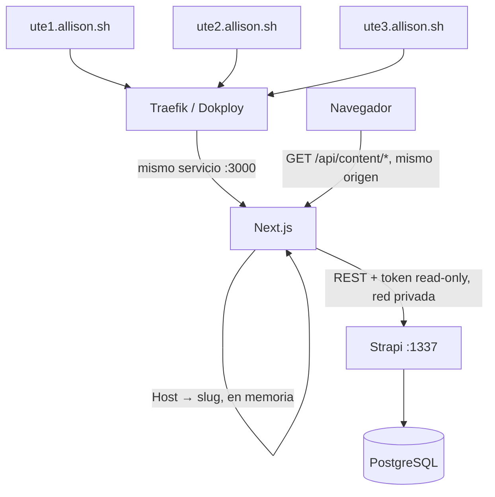

# Arquitectura

## Traefik y los tres dominios
En Dokploy los tres dominios se agregan a **la misma aplicación** (puerto 3000). Dokploy genera un router de Traefik por dominio, todos hacia el mismo contenedor, y Traefik gestiona los certificados. Traefik conserva el header `Host` original al reenviar.

## Resolución de tenant
`web/src/lib/tenants.ts` contiene un objeto `host → slug`. Es una búsqueda en memoria: sin base de datos, sin Strapi, sin middleware. Se normaliza el host (minúsculas, sin puerto ni punto final) y se verifica con `Object.hasOwn`. Host desconocido → `notFound()` (404); no existe tenant por defecto.

**Supuestos de confianza:** solo se lee `Host`. No se usa `X-Forwarded-Host`: Traefik ya conserva `Host`, y un header reenviado podría falsificarse si alguien alcanzara el contenedor sin pasar por Traefik. Incluso así, un host no listado da 404, de modo que lo peor que puede hacer un cliente es pedir uno de los tres sitios válidos. El contenedor no debe publicarse en un puerto del host; solo Traefik lo alcanza.

## Páginas
`/`, `/carreras`, `/carreras/[slug]` (malla curricular y profesores), `/profesores`, `/anuncios`. Todas resuelven el tenant por `Host`; una carrera que no pertenece al sitio da 404.

## Contenido compartido vs. específico
Modelos: `Site`, `Career`, `Professor`, `Announcement` (cada uno con relación **muchos-a-muchos** con `Site`) y `Course` (ramo de la malla, pertenece a una carrera). `Professor` también se relaciona con `Career`. La UI muestra una etiqueta “También en …” a partir de los `sites` de cada registro; si el registro es exclusivo, no muestra nada.

## Contenido propio de cada sitio (`Page`)
`Page` pertenece a **un** `Site` (muchos-a-uno) y se identifica por `slug`: `nosotros` (título, introducción, cuerpo en markdown, imagen, cifras `stats` y `values`) y `carreras`, `profesores`, `anuncios` (título e introducción de cada sección). Los editores lo modifican en Strapi → Content Manager → Page, eligiendo el sitio. `SiteInfo.pages` lleva los títulos e introducciones en todas las rutas; `/nosotros` pide la página completa. Si un sitio no tiene `nosotros`, responde 404; si no tiene el título de una sección, se usa uno por defecto.
- *Compartido:* un anuncio relacionado con los 3 sitios es **una** fila; editarlo en Strapi cambia los tres sitios.
- *Específico:* un anuncio/carrera relacionado con un solo sitio solo aparece allí.

El filtrado lo hace Strapi: `filters[sites][slug][$eq]=<slug>`, con `fields` explícitos. Strapi 5 devuelve respuestas planas con `documentId`; solo se consultan documentos **publicados** (Draft & Publish activo; un registro en borrador no se ve en el sitio).

## React Query
1. `page.tsx` resuelve el tenant, crea un `QueryClient` **por petición**, llama `fetchQuery` con claves como `["home", slug]`, `["careers", slug]` o `["career", slug, carrera]` (acceso directo a Strapi, sin HTTP propio) y entrega `dehydrate()` en un `HydrationBoundary`.
2. `Home` (client component) usa `useQuery` con la misma clave. Los datos ya están hidratados, así que el HTML inicial ya trae el contenido y no hay loading.
3. Todas las claves incluyen el slug, así que cada sitio tiene su caché independiente. Cada página prefetchea en paralelo lo que necesita, más `["site", slug]` para cabecera y pie.
4. `queryFn` del cliente = `GET /api/content/<kind>` (mismo origen, lista cerrada de `kind`). El servidor deduce el sitio por `Host`; el navegador no envía ningún identificador de tenant.

Se usa `fetchQuery` en lugar de `prefetchQuery` a propósito: si Strapi cae, se prefiere un 500 a una página vacía que reintenta en el navegador.

## Dueño de cada caché
| Capa | Política |
|---|---|
| Next.js | Sin caché: `fetch(..., {cache: "no-store"})`, ruta dinámica (lee `Host`). Cada carga de página consulta Strapi. |
| React Query (navegador) | `staleTime` 60 s, sin refetch al enfocar. Es la única caché del cliente. |
| HTTP | `/api/content/*` responde `no-store` y `Vary: Host`. |

Frescura: un cambio en Strapi es visible en la **siguiente carga de página** (el SSR siempre consulta). En una pestaña ya abierta aparece al refrescar el `staleTime` y volver a montar/refetch. Sin webhooks ni invalidación.

## Seguridad de los datos
`STRAPI_URL` y `STRAPI_API_TOKEN` se leen solo en código de servidor (sin prefijo `NEXT_PUBLIC_`), el token es *read-only* y el navegador solo ve `/api/content/*` del mismo origen. Los tests verifican que el token no esté en el bundle ni en las respuestas.
